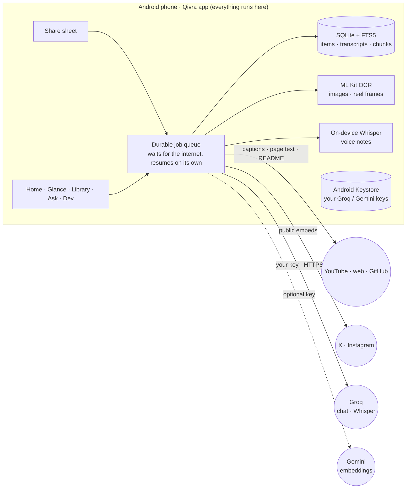

<div align="center">


# Qivra

**Turn what you save into what you know.**

A private, local-first knowledge vault for Android. Share a reel, video, web page or note, and Qivra transcribes it, summarises it and makes it searchable and askable, on your phone.

[](https://github.com/deekshith-b48/Qivra/releases/latest)
[](LICENSE)
[](https://github.com/deekshith-b48/Qivra/releases/latest)
[](https://docs.expo.dev/)
[](https://github.com/deekshith-b48/Qivra/actions/workflows/build.yml)

[Download](https://github.com/deekshith-b48/Qivra/releases/latest) · [Features](#features) · [Quick start](#quick-start) · [How it works](#how-it-works) · [Development](#development) · [Contributing](#contributing)

</div>

<p align="center">
  
  
  
  
  
</p>

## Watch the overview

<p align="center">
  <a href="https://github.com/deekshith-b48/Qivra/releases/download/v2.0.0/Qivra-2.0.0-overview.mp4">
    
  </a>
  <br />
  <sub><b><a href="https://github.com/deekshith-b48/Qivra/releases/download/v2.0.0/Qivra-2.0.0-overview.mp4">▶ Play the 60-second overview</a></b> · 1080×1920 MP4 with voiceover and captions</sub>
</p>

## Why Qivra

Saved posts pile up and are never seen again. Qivra keeps them **useful**: every link becomes a transcript, a one-line summary, timestamped key moments and highlighted keywords, all stored in a SQLite database **on your phone**. You can search it offline and ask questions that are answered from your own library, with citations.

- **No server, no laptop:** install the app, add your free Groq key, and every feature works on the phone over the internet.
- **Local-first:** your library lives on the device. No account, no cloud database.
- **Bring your own AI key:** each user adds their own free Groq key during setup. No key ships in the app.
- **Works without AI:** search, transcripts, extractive summaries and flashcards still work with no key at all.

## Features

| | |
|---|---|
| **Capture** | Share from Instagram, X, YouTube, a browser or any app and keep scrolling. Paste a link, write a note, record a voice note, or import files, screenshots and transcripts (SRT, VTT, TXT). Shares survive the app being killed. |
| **Understand** | YouTube captions are fetched on the phone. X and Instagram videos, imported audio/video files and voice notes of up to 12 minutes are transcribed by Groq Whisper with your own key, straight from the phone (Instagram when the post's public embed shares the video; otherwise its caption is used). On-screen text in silent reels and text in images are read on the phone. GitHub links keep their README as Markdown. Each item gets a TL;DR, key moments linked to timestamps, and keyword highlights. |
| **Ask & learn** | Chat with your whole library or one item. Answers stream, cite numbered sources and jump to the right second of a video. Make flashcards from any item and review them with spaced repetition. Daily, weekly and topic reports export as Markdown or PDF. |
| **Organise** | Library grid or list, full-text search (SQLite FTS5) and search by meaning (your Groq key rewrites the query into synonyms and translations; add an optional free Gemini key for true vector search and Related items), smart collections, favourites, highlights and revisit reminders. Swipe to archive or delete, with undo. |
| **Dev mode** (opt-in) | A Dev tab with AI trends from GitHub, Hacker News and Hugging Face; Claude Code skills, plugins and MCP servers (top or new this week); follow-ups on topics you choose, with new releases of repos you follow; a daily-habit streak with a 5-week heatmap and a weekly recap; and a searchable toolbox of the repos, tools and commands in your library, grouped by tool. Hidden unless you turn it on. |
| **Privacy** | Keys in Android's Keystore, no backups to the cloud, permissions asked only when needed, and saved content treated as untrusted (commands are shown, never run). |

<details>
<summary>More screenshots</summary>
<p align="center">
  
  
  
</p>
</details>

## Quick start

### 1. Install the app

Download **`Qivra-2.2.0-release.apk`** from the [latest release](https://github.com/deekshith-b48/Qivra/releases/latest) and open it on your phone (Android 7.0 or newer). Allow your file manager to install unknown apps when Android asks.

> The APK is signed with the Android debug key and is meant for sideloading. Check the download against the `.sha256` file attached to the release.

### 2. Add your own Groq key

The setup screens ask for an AI key. Groq's tier is free and fast:

1. Tap **Get a free Groq key**, sign in at [console.groq.com/keys](https://console.groq.com/keys) and create a key.
2. Paste it into **Your Groq API key** and tap **Verify & save**.

Qivra sends a tiny test request, then stores the key in Android's secure storage. It is sent only to Groq, and only when you ask, summarise or save a video (the video's audio is sent for its transcript). Tap **Later** to skip; you can add it any time under **Settings → AI models**.

That's it. There is no server and no laptop to set up: the app talks to the internet directly. Optional: for true search by meaning, add a free [Gemini key](https://aistudio.google.com/apikey) under **Settings → AI models → Search by meaning**.

## How it works



1. **Capture.** A share writes an envelope to disk, starts a foreground service and returns you to the app you were in.
2. **Process.** Each step (metadata, transcript, summary, index) is a row in a durable `jobs` table. Steps retry with backoff and recover after a crash. Without internet a step waits instead of failing, and continues by itself when the phone is back online.
3. **Transcribe.** YouTube captions are fetched directly. X and Instagram videos are found through their public embeds and sent to Groq Whisper with your key; silent reels are read frame by frame with on-device OCR.
4. **Enrich.** The model gets the transcript with `[mm:ss]` markers. Timestamps are snapped to real segments, and keywords that are not in the source are dropped.
5. **Use.** Search, Ask, flashcards and reports read the local database. Ask answers only from your saved items and cites them.

Read more in [Architecture](docs/ARCHITECTURE.md), [AI providers and transcripts](docs/AI_PROVIDERS_AND_TRANSCRIPTS.md) and [Voice and transcription](docs/VOICE_AND_TRANSCRIPTION.md).

## Configuration

Everything is set in the app:

| Setting | Where | Purpose |
|---|---|---|
| Groq key | Setup screens, or **Settings → AI models** | AI answers, summaries, flashcards, and transcripts of X / Instagram videos, imported media and long voice notes. Free at [console.groq.com/keys](https://console.groq.com/keys). |
| Gemini key (optional) | **Settings → AI models → Search by meaning** | True vector search and Related items. Free at [aistudio.google.com/apikey](https://aistudio.google.com/apikey). |
| Voice model | **Settings → Speech & dictation** | On-device Whisper or Parakeet for private voice notes and dictation, or Groq for notes up to 12 minutes. |
| Auto-transcribe | **Settings → AI & processing** | Transcribe shared videos automatically. |

## Privacy & security

- **Your key, your account.** The app ships no API key. Each user's key is stored in Android's Keystore and is never logged, synced or exported.
- **No server:** nothing goes through a Qivra server. The phone calls Groq (and Gemini, if you add it) directly over HTTPS with your own key; other requests are public lookups (YouTube captions, page text, X/Instagram embeds).
- **Network:** hosted providers must use HTTPS.
- **Content:** saved text is untrusted data. It cannot instruct the AI, and commands in it are never executed.

Full details: [Security and privacy](docs/SECURITY_AND_PRIVACY.md). To report a vulnerability, please open a private [security advisory](https://github.com/deekshith-b48/Qivra/security/advisories/new) rather than a public issue.

## Development

**Requirements:** Node.js 20+, JDK 17–21, Android SDK 36 with NDK 28, Python 3.11+. Expo Go is not supported (the app has native code).

```bash
npm ci
npx tsc --noEmit                                   # type check
npx jest                                           # app tests (logic + UI)
```

**Build the release APK:**

```bash
QIVRA_ANDROID_ABIS=arm64-v8a,x86_64 npx expo prebuild --platform android --clean --no-install
echo "sdk.dir=$ANDROID_HOME" > android/local.properties
cd android && ./gradlew assembleRelease
```

The APK is written to `android/app/build/outputs/apk/release/app-release.apk`.

### Project structure

```
├── App.tsx                 navigation, deep links, notification taps
├── src/
│   ├── core/               pure TypeScript: URLs, metadata, captions, highlights, search, reports
│   ├── db/                 SQLite schema, migrations and repository
│   ├── services/           side effects: capture, jobs, share task, AI, voice, reminders
│   ├── screens/            Home, Glance, Library, Ask, Dev, item page, settings
│   └── ui/                 design tokens, theme and shared components
├── plugins/                Expo config plugin + native Kotlin share target and service
├── server/                 old self-hosted server (unsupported; the app no longer uses it)
├── __tests__/              Jest suites (core, db, ui)
└── docs/                   architecture, security, test results
```

`src/core` has no React Native imports, so it is tested directly. Native code is limited to two Kotlin files in `plugins/android`.

## Roadmap

- [ ] Signed release builds and an F-Droid listing
- [ ] iOS share extension
- [ ] Encrypted export and restore
- [ ] On-device embeddings, so search by meaning works without any key

Ideas and votes are welcome in [Issues](https://github.com/deekshith-b48/Qivra/issues).

## Contributing

Contributions are welcome.

1. Open an issue first for larger changes, so we can agree on the approach.
2. Fork, create a branch, and keep the change focused.
3. Add a test for any new logic or bug fix, and run `npx tsc --noEmit`, and `npx jest`.
4. Open a pull request that explains what changed and why, with screenshots for UI changes.

Match the existing style: small functions, shared components from `src/ui`, and no secrets in code or commits.

## License

Qivra is free software under the [GNU Affero General Public License v3.0](LICENSE). If you run a modified version for others, you must share its source.

## Acknowledgements

Qivra began as a fork of [SuperBrain](https://github.com/sidinsearch/superbrain) by sidinsearch, also under the AGPL-3.0. Copyright notices and the list of changes are in [NOTICE.md](NOTICE.md). Thanks to the authors of React Native, Expo, whisper.cpp, Groq, FastAPI and the other open-source projects Qivra builds on.
