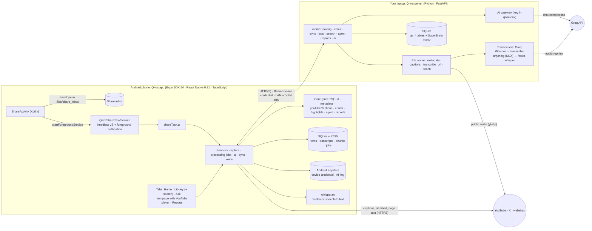
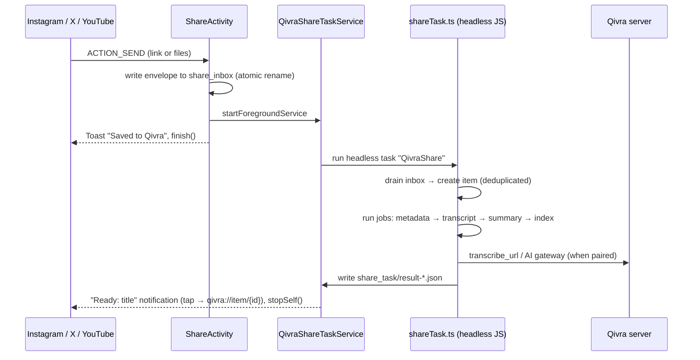
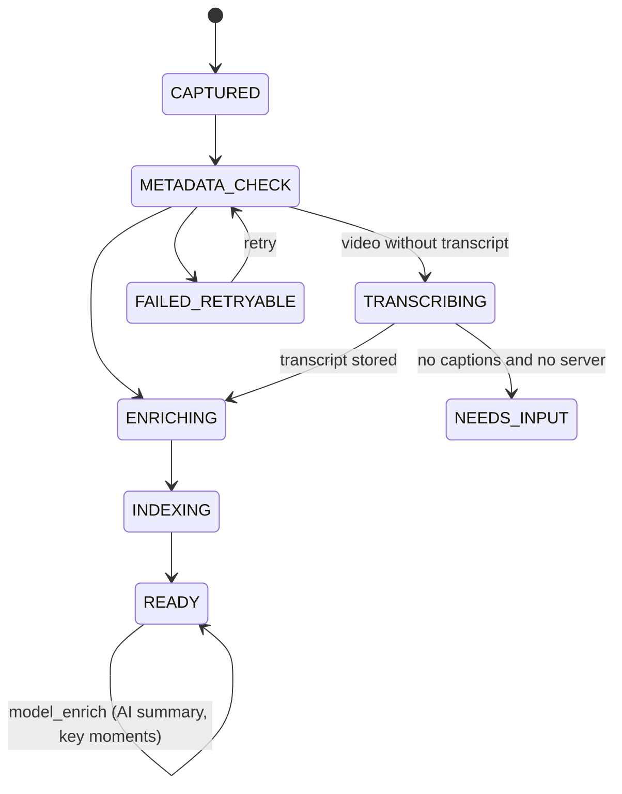

# Qivra

**A private, local-first knowledge vault for Android.**

Share a reel, a post, a video or a web page to Qivra and keep scrolling. Qivra saves it on your phone, transcribes it, writes a one-line summary with timestamped key moments, highlights the phrases that matter, and notifies you when it is ready. You can then search everything you saved and ask questions that are answered from your own library, with citations.

[](https://github.com/deekshith-b48/Qivra/releases/latest)
[](https://github.com/deekshith-b48/Qivra)
[](LICENSE)

## Get Qivra

**[Download the latest APK (1.6.0)](https://github.com/deekshith-b48/Qivra/releases/latest)**: package `com.qivra.app`, Android 7.0 or newer. Open the APK on your phone and allow your file manager to install unknown apps when Android asks. It installs as its own app, next to SuperBrain.

> The APK is signed with the Android debug key. It is meant for personal use and sideloading, not the Play Store.

## Features

### Find your way around
- **Three tabs and a "+" button:** **Home** shows what needs you, **Library** holds and searches everything, and **Ask** answers questions about your library. The centre **+** pastes a copied link, writes a note, records a voice note or imports a file.
- **Home feed:** **Ready to review** (new and ready), **Needs you** (needs a transcript or failed), **In progress**, and one older item **from your library** each day. An opt-in **daily digest** notification arrives at 9 am.
- **Watch inside Qivra:** YouTube items play on the item page. Tap a key moment, a transcript line or an Ask citation to jump straight to that second, and the line being spoken is highlighted as it plays.
- **Library grid and swipe actions:** videos, websites and notes show as a 2-column grid, and the toggle switches to a list. In the list, **swipe right to archive** and **swipe left to add to a collection or delete**. Each action shows an **Undo** bar for 8 seconds, and a delete isn't written until that bar closes. The same actions are in TalkBack's actions menu.
- **Ask about this:** every item has a button to chat with just that video or page. Answers cite its moments.

### Save from anywhere, without leaving the app you are in
- **Share sheet capture.** Share from Instagram, X, YouTube, a browser or any app. A toast confirms the save, and a short "Preparing transcript and summary…" notification shows while Qivra works. When it is done, a **"Ready: <title>"** notification with the summary opens the item.
- **Libraries by kind.** Saved items are sorted into **Videos** (YouTube, Instagram, X), **Websites** (articles, docs, GitHub) and **Notes** (your notes, voice notes and imported files).
- **Offline-safe.** Each share is written to disk before anything else runs, so it survives the app being killed or the network dropping.

### Automatic transcripts
| Source | How the transcript is made |
|---|---|
| YouTube | Published captions are fetched **on the phone**, with real timestamps. |
| Instagram reels, X videos | Your paired **Qivra server** downloads the public audio (yt-dlp, no cookies) and transcribes it with **Groq Whisper large-v3-turbo**, typically in a few seconds. It falls back to local Whisper on your laptop (transcribe-anything with MLX, or faster-whisper). |
| Websites, GitHub | The readable article text, or the README, is extracted and indexed. |
| Files and imports | SRT, VTT or TXT transcripts, and audio or video files (transcribed by the server). |
| Voice notes | Recorded and transcribed **on the phone** with whisper.cpp (Whisper tiny, base or small, or NVIDIA Parakeet v3). Dictation also works in Notes, Search and the Agent. |

Qivra never makes up a transcript. A music-only reel finishes as "No speech to transcribe", and a video without captions asks you for one.

### Summaries, key moments and highlights
- **TL;DR:** a one-sentence summary, labelled "AI-generated" when a model wrote it. Without a model, Qivra writes an extractive summary on the device.
- **Key moments:** the important points, each linked to its timestamp. Tap one to open the video at that second.
- **Keyword highlights:** concepts copied word for word from the source, plus tools and recurring phrases, highlighted across the summary and the transcript. Tap a keyword to see only the lines that mention it.
- **Tools, repos and commands** are pulled out as they appear in the source. Commands are shown and can be copied, but are never run.

### Search, ask and report
- **Search from the Library bar:** full-text search on the device with SQLite FTS5, works offline. Results are grouped by item, and transcript matches show their timestamps. Semantic search is added when an embedding model is configured.
- **Ask:** questions across the whole library, or about one item. Answers come only from your saved items and cite numbered sources [S1]. Saved content is treated as untrusted data, which guards against prompt injection. Without a model, Qivra returns the matching passages instead.
- **Reports:** daily, weekly, topic or a selection of items, with sources and gaps.
- **Collections, tags, notes and transcript corrections**, plus export and delete-everything under Privacy & storage.

### Your own server (optional)
- **QR pairing:** a one-time code that expires after 5 minutes, and a separate credential for each device. LAN access is opt-in.
- **Sync** across devices, with revisions, conflict resolution and tombstones for deleted items.
- **AI gateway:** put a provider key (for example Groq) in `server/qivra.env`. Paired phones get AI answers and summaries without any setup on the phone, and **the key never leaves your laptop**.

## Architecture



**Layers in the app.** `src/core` is pure TypeScript with no React Native imports, so it is unit-tested directly. `src/db` holds the schema, migrations and repository. `src/services` holds the side effects: files, network, jobs and secure storage. `src/screens` and `src/ui` are the interface. `src/sync` is the sync engine. Native code is limited to two Kotlin files under `plugins/android`, which `plugins/withQivraAndroid.js` copies into the project during `expo prebuild`.

## System design

### Share flow: the user stays in the source app



Why it is built this way:
- **Foreground service.** Android freezes a plain background service about 10 s after the share screen closes.
- **Result file.** React Native's task-finished callback does not reach headless services under the New Architecture, so the task signals the service through a file instead.
- **Native notification.** The tap still deep-links correctly when the app was started headless.

### Processing pipeline

Every unit of work is a row in the **durable `jobs` table**. Jobs have idempotent ids and are claimed atomically. They retry with exponential backoff and are recovered after the process dies. They run on app start and resume, after a capture, in the headless share task, and from a WorkManager background task.



- **Server jobs** (`server_transcribe_url` and others) start a job on the server and poll it without using up attempts. If the laptop is asleep, the job waits (`SERVER_UNREACHABLE`) and is resumed as soon as the server answers again.
- **AI enrichment** sends the transcript with `[mm:ss]` markers. The model returns a TL;DR, key moments, concepts and tags. Timestamps are snapped to real segment starts (±2 s) or dropped, and any concept that does not occur in the source is discarded.

### Data and sync
- **On the phone:** `items`, `transcripts` and `transcript_segments`, `chunks` with the `chunks_fts` FTS5 index and optional `embeddings`, plus `media`, `jobs`, `collections`, `reports`, `conversations` and `message_citations`, `conflicts` and `usage_events`. Schema versions use `PRAGMA user_version`.
- **Sync** is revision-based. The phone pushes changes since a cursor and pulls the server's sequence. Edits made on two devices become conflicts, with keep-local, keep-server or keep-both options. Revisions made by the server, such as metadata or a transcript it added, are rebased instead of raised as conflicts. Deletes travel as tombstones.

### Security model
- **Pairing:** one-time 40-bit codes with a 5-minute TTL, consumed atomically and rate-limited per IP and globally. Device tokens (`qv1_…`) are stored only as SHA-256 hashes on the server and in Keystore-backed storage on the phone.
- **Server:** admin routes answer only on loopback. Host and Origin headers are checked against DNS rebinding. Payload and upload sizes are capped. Server-side fetches are guarded against SSRF, uploads cannot traverse paths, and no secret is ever logged.
- **Network:** cleartext HTTP is refused unless the host is on a private, LAN or VPN address, and hosted AI providers must use HTTPS.
- **Content:** imported text is treated as untrusted. Commands are never executed, and the Agent's write tools need your confirmation.
- **Permissions:** each one is requested when you first use the feature that needs it: camera for QR scanning, microphone for recording, notifications on the first share or when you turn on the digest. The clipboard is read only when you tap "Paste copied link".
- **Backups:** Android cloud and device-transfer backup are disabled.

See [Security and privacy](docs/SECURITY_AND_PRIVACY.md) for the full threat notes.

## Run your own server

```bash
cd server
python3 -m venv .venv
.venv/bin/pip install -r requirements-qivra.txt -r requirements-media.txt
cp qivra.env.example qivra.env
.venv/bin/python -m qivra serve --lan
```

In `qivra.env`, set `QIVRA_AI_API_KEY` (for example a Groq key) and keep `QIVRA_TRANSCRIBER=groq` for fast cloud transcription. Remove that line to keep all audio on your laptop. The server prints its LAN address, a one-time Access ID and a QR code. In Qivra, open **Settings → Connect to My Server → Scan QR code**.

Optional: `pip install -r requirements-transcribe-anything.txt` adds MLX-accelerated Whisper on Apple Silicon as the local engine. See [Local server and QR pairing](docs/LOCAL_SERVER_AND_QR_PAIRING.md) and [Voice and transcription](docs/VOICE_AND_TRANSCRIPTION.md).

## Development

Requirements: Node.js 20+, JDK 17–21, Android SDK 36 with NDK 28, and Python 3.11+.

```bash
npm ci
npx tsc --noEmit
npx biome lint src App.tsx index.ts __tests__ plugins
npx jest
cd server && .venv/bin/python -m pytest -q tests
```

Build the release APK:

```bash
QIVRA_ANDROID_ABIS=arm64-v8a,x86_64 npx expo prebuild --platform android --clean --no-install
echo "sdk.dir=$ANDROID_HOME" > android/local.properties
cd android && ./gradlew assembleRelease
```

The APK is written to `android/app/build/outputs/apk/release/app-release.apk`. Expo Go is not supported because the app includes native code. An emulator reaches a server on the same machine at `http://10.0.2.2:<port>`.

## Project map

| Path | Purpose |
|---|---|
| `App.tsx`, `src/screens/`, `src/ui/` | Navigation, screens and shared components |
| `src/core/` | Pure logic: URL normalisation, metadata and readable text, YouTube captions, enrichment, highlights, agent, reports |
| `src/db/`, `src/sync/` | SQLite schema, migrations, repository and the sync engine |
| `src/services/` | Capture, processing jobs, headless share task, AI provider, voice, pairing, background work |
| `plugins/` | Expo config plugin and the native Kotlin share target and headless service |
| `server/qivra/` | Qivra server: API, pairing, security, jobs, media, transcribers, AI gateway |
| `server/core/`, `server/analyzers/` | SuperBrain backend components |
| `docs/` | [Architecture](docs/ARCHITECTURE.md), [AI providers and transcripts](docs/AI_PROVIDERS_AND_TRANSCRIPTS.md), [security](docs/SECURITY_AND_PRIVACY.md), [migration](docs/SUPERBRAIN_TO_QIVRA_MIGRATION.md), [test results](docs/TEST_RESULTS.md) |

## Lineage and license

Qivra is built on [SuperBrain](https://github.com/sidinsearch/superbrain). The migration and licensing context is in [SuperBrain to Qivra migration](docs/SUPERBRAIN_TO_QIVRA_MIGRATION.md). Licensed under **AGPL-3.0**; see [LICENSE](LICENSE).
